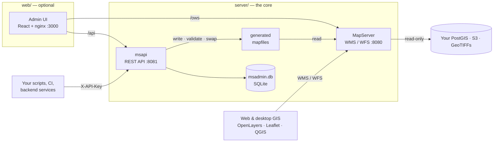

<p align="center">
  <picture>
    <source media="(prefers-color-scheme: dark)" srcset="docs/assets/wordmark-dark.svg">
    
  </picture>
</p>

<p align="center">
  <strong>Lightweight map publishing, powered by <a href="https://mapserver.org">MapServer</a>.</strong><br>
  A GeoServer-style REST API and admin UI for publishing PostGIS, S3 and GeoTIFF data as WMS / WFS.
</p>

<p align="center">
  <a href="https://github.com/souvik-das-tech/mapnest/actions/workflows/ci.yml"></a>
  <a href="https://github.com/souvik-das-tech/mapnest/actions/workflows/security.yml"></a>
  <a href="LICENSE"></a>
  
  
  
</p>

<p align="center">
  <a href="#quick-start">Quick start</a> ·
  <a href="#two-ways-to-use-it">API only or API + UI</a> ·
  <a href="docs/api-guide.md">API guide</a> ·
  <a href="docs/README.md">Documentation</a> ·
  <a href="SECURITY.md">Security</a>
</p>

---

## Why MapNest?

GeoServer is powerful, but it is a Java application that usually wants 1–2 GB of
heap, a dense admin UI and a lot of clicking. If you are building a GIS app and
mostly need to **publish layers and style them**, that is a lot of machinery.

MapNest keeps the GeoServer workflow you know (**workspaces → stores → layers →
styles**) and puts it on top of **MapServer**, the fast C map engine from OSGeo:

| | GeoServer | **MapNest** |
|---|---|---|
| Idle memory (whole stack) | ~1–2 GB JVM heap | **~115 MB** (measured) |
| Start-up | tens of seconds | **seconds** |
| Configure by API | REST API | **REST API, every feature** (OpenAPI 3) |
| Styles | SLD | **Your existing SLD** (converted once), or a short JSON format |
| Config storage | XML data directory | **One SQLite file**; mapfile generated, validated and versioned |
| Your data | read/write possible | **Read-only** by design |

**Throughput:** 182 WMS GetMap requests/s with p95 latency of 35 ms on a laptop
([details](docs/architecture.md#performance)).

GeoServer is still the better choice if you need built-in tile caching
(WMTS/GeoWebCache), WPS processing, or per-user security across many workspaces.

## Features

- **Stores**: PostGIS databases, S3-compatible buckets (AWS, MinIO, SeaweedFS…)
  and local raster folders. Every connection is tested before it is saved.
- **Layers**: publish tables, views and GeoTIFF / Cloud Optimized GeoTIFF files.
  Geometry type, SRID, extent and bands are detected for you; missing SRIDs get
  suggestions. Non-COG rasters get an automatic fast copy.
- **Styles**: upload GeoServer **SLD 1.0 / SE 1.1** (filters, scale ranges,
  marks, icons, labels, raster colour maps). Unsupported parts are reported, never
  silently dropped. Several styles per layer, chosen with WMS `STYLES=`.
- **Icons**: upload PNGs once, reference them from SLD by file name.
- **Workspaces**: group stores per project or client, each with its own
  `/ows/<workspace>` endpoint.
- **Safe changes**: every change regenerates the MapServer mapfile, validates it
  with MapServer **before** it goes live, swaps it atomically and keeps the last
  50 versions for one-click rollback. No restarts.
- **Admin UI**: guided wizards, live map previews, style editor with instant
  preview, attribute statistics for classified styles, map viewer with
  GetFeatureInfo, copy-paste snippets for OpenLayers, Leaflet and QGIS.
- **Operations**: one-file backup and restore, health checks, structured JSON
  logs with an audit trail.
- **Secure by default**: no default password, sign-in lockout, server-side
  sessions, strict security headers, encrypted secrets, hardened containers,
  and a [VAPT Level 1 checklist](docs/security/VAPT-L1.md).

## Two ways to use it

MapNest ships as two independent Docker stacks. **Run only what you need.**



| | **API only** | **API + Admin UI** |
|---|---|---|
| Run | `server/` | `server/` and `web/` |
| Best for | Automation, CI/CD, infrastructure-as-code, embedding map publishing in your own product | Teams that also want to click through stores, layers and styles |
| You use | `curl` / any HTTP client with `X-API-Key` | Browser sign-in; the same API underneath |
| Extra footprint | none | ~15 MB (nginx) |

The UI has no private back door: **everything it does is a public API call**, so
anything you can do in the UI you can script, and vice versa.

## Quick start

Requirements: Docker with Compose v2.24 or newer. Nothing else is installed on
the host.

### 1. The core: API + MapServer

```bash
git clone https://github.com/souvik-das-tech/mapnest.git
cd mapnest
docker network create gis-net                      # once per host

cd server
cp .env.example .env
# Fill in three secrets in server/.env:
#   MSAPI_ADMIN_PASSWORD   your own, at least 12 characters
#   MSAPI_API_KEY          openssl rand -hex 32
#   MSAPI_SECRET_KEY       openssl rand -base64 32
docker compose up -d --build
curl -s localhost:8081/api/v1/health               # {"status":"ok", ...}
```

MSAPI refuses to start with missing, short or well-known secrets and tells you
why in `docker logs msapi`.

### 2a. Use it from the API

Publish a PostGIS table and style it, in four calls:

```bash
export API=http://localhost:8081/api/v1  H="X-API-Key: <your MSAPI_API_KEY>"

# 1. connect a database (tested before it is saved; use a read-only role)
curl -sH "$H" -X POST $API/stores -H 'Content-Type: application/json' -d '{
  "name": "city_db", "type": "postgis",
  "connection": {"host": "db.example.com", "database": "gis", "user": "map_reader", "password": "…"}}'

# 2. publish a table (geometry, SRID and extent are detected)
curl -sH "$H" -X POST $API/layers -H 'Content-Type: application/json' \
  -d '{"name": "roads", "title": "Roads", "store": "city_db", "table": "roads"}'

# 3. upload your GeoServer SLD
curl -sH "$H" -X POST "$API/styles?name=roads_by_class" \
  -H 'Content-Type: application/vnd.ogc.sld+xml' --data-binary @roads.sld

# 4. make it the layer's default style
curl -sH "$H" -X PUT $API/layers/roads/styles -H 'Content-Type: application/json' \
  -d '{"default": "roads_by_class"}'
```

The layer is live at once:

```
http://localhost:8080/?SERVICE=WMS&REQUEST=GetCapabilities
```

Continue with the **[API guide](docs/api-guide.md)**: S3 and GeoTIFF layers,
workspaces, icons, previews, versions, backups, and the full
[OpenAPI 3 spec](server/msapi/internal/api/openapi.yaml).

### 2b. Add the Admin UI (optional)

```bash
cd ../web
cp .env.example .env
docker compose up -d --build
```

Open <http://localhost:3000> and sign in as `admin` with your
`MSAPI_ADMIN_PASSWORD`. For HTTPS with an automatic Let's Encrypt certificate:

```bash
# in web/.env: MAPNEST_DOMAIN=maps.example.com  MAPNEST_ACME_EMAIL=you@example.com
docker compose -f docker-compose.yml -f docker-compose.tls.yml up -d --build
```

## Use the maps in your app

MapNest serves standard OGC services, so any client works.

**OpenLayers**

```js
import TileLayer from "ol/layer/Tile";
import TileWMS from "ol/source/TileWMS";

const roads = new TileLayer({
  source: new TileWMS({
    url: "https://maps.example.com/ows",
    params: { LAYERS: "roads", STYLES: "roads_by_class", TILED: true },
  }),
});
```

**Leaflet**

```js
L.tileLayer.wms("https://maps.example.com/ows", {
  layers: "roads", styles: "roads_by_class", format: "image/png", transparent: true,
}).addTo(map);
```

**QGIS**: *Layer → Add Layer → Add WMS/WMTS Layer*, URL
`https://maps.example.com/ows` (or `/ows/<workspace>` for one workspace).

## Documentation

| Guide | What is in it |
|---|---|
| [API guide](docs/api-guide.md) | Using MapNest headless: authentication, every resource, end-to-end examples |
| [Styling](docs/styling.md) | Supported SLD, the JSON style format, icons, labels, raster colour maps |
| [Configuration](docs/configuration.md) | Every environment variable for both stacks |
| [Deployment](docs/deployment.md) | Single host, separate hosts, HTTPS, upgrades, backups |
| [Architecture](docs/architecture.md) | How the pieces fit, the mapfile pipeline, performance |
| [Security](SECURITY.md) · [VAPT L1](docs/security/VAPT-L1.md) | Security model, production checklist, every control with a test |
| [Design notes](PLAN.md) | The original design and progress log |

## Security

MapNest is built to pass a Level 1 vulnerability assessment out of the box: no
default credentials, sign-in lockout, server-side sessions with idle timeout,
strict CSP and security headers, rate limits, hidden server versions, AES-256-GCM
encrypted secrets, read-only data access, an audit log and hardened containers.
CI runs tests, `govulncheck`, `npm audit`, Trivy, CodeQL and gitleaks.

See [SECURITY.md](SECURITY.md) for the production checklist and how to report a
vulnerability privately.

## Project layout

```
server/            core stack: MapServer + msapi (Go REST API)
  msapi/           the API: cmd/, internal/{api,config,store,mapfile,sld,inspect,...}
  mapserver/       MapServer and Apache configuration
web/               optional stack: React admin UI served by nginx
  src/             features/{stores,layers,styles,icons,map,system,...}
  nginx*, tls/     reverse proxy, security headers, optional HTTPS (Caddy)
docs/              guides, security checklist, logo
dev/               sample SLDs and icons, k6 load test
```

## Contributing

Issues and pull requests are welcome. Read [CONTRIBUTING.md](CONTRIBUTING.md) and
the [Code of Conduct](CODE_OF_CONDUCT.md). Everything (tests, builds, the dev
server) runs in Docker, so you do not need Go or Node installed.

## Credits

All map rendering, WMS and WFS are done by **[MapServer](https://mapserver.org)**,
an [OSGeo](https://www.osgeo.org) project, run from the stock
[`camptocamp/mapserver`](https://github.com/camptocamp/docker-mapserver) image.
Raster access uses [GDAL](https://gdal.org). MapNest manages MapServer's
configuration; the heavy lifting belongs to the MapServer and GDAL communities.

## License

[Apache License 2.0](LICENSE) © 2026 Souvik Das. MapServer, GDAL and the other
components keep their own licenses; see [NOTICE](NOTICE).
