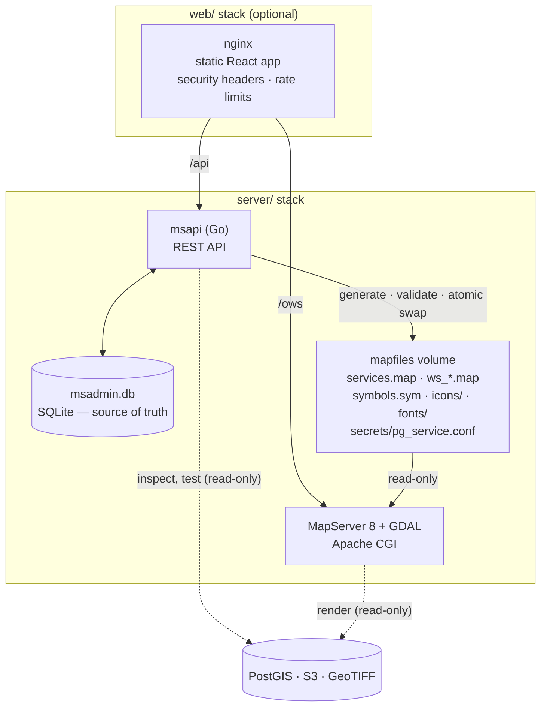

# Architecture

MapNest is deliberately small: one Go service that writes configuration, the
stock MapServer image that serves maps, and an optional static web app.



## Components

| Component | Technology | Role |
|---|---|---|
| **msapi** | Go 1.26, standard library HTTP, `pgx`, `minio-go`, pure-Go SQLite | REST API, validation, SLD conversion, mapfile generation, backups |
| **MapServer** | `camptocamp/mapserver` 8.6 with GDAL 3.13 | All rendering, WMS and WFS |
| **web** | React 19, TypeScript, Vite, Tailwind, TanStack Query, OpenLayers, CodeMirror; nginx | Admin UI and same-origin proxy |
| **Caddy** (optional) | Caddy 2 | HTTPS with automatic certificates |

msapi is built on the **same image as MapServer**, so the `mapserv` and GDAL it
uses for validation and inspection are exactly the versions that render.

## Key design rules

1. **The database is the source of truth.** Workspaces, stores, layers, styles
   and icons live in one SQLite file. The mapfile is always generated from it and
   never edited by hand.
2. **Validate before going live.** A generated mapfile is written to a temporary
   file, checked by `mapserv`, and only then renamed over the live one. MapServer
   never sees a half-written or invalid mapfile. If validation fails, the API
   returns `422` and the change is undone.
3. **No restarts.** MapServer reads the mapfile on each request, so changes are
   live as soon as the API answers.
4. **Every version is kept.** The last 50 generated mapfiles are stored for
   inspection and one-call rollback.
5. **One writer.** File writes are serialised inside msapi; SQLite runs in WAL
   mode for concurrent reads.
6. **Your data is read-only.** PostGIS sessions are opened read-only, raster
   folders are mounted read-only, and nothing is ever written to a bucket.

## What gets generated

| File | Content |
|---|---|
| `services.map` | Every enabled layer: the shared `/ows` endpoint |
| `ws_<workspace>.map` | One per workspace, only its layers: `/ows/<workspace>` |
| `symbols.sym` | Built-in marks and one pixmap symbol per used icon |
| `secrets/pg_service.conf` | libpq services with the database passwords, so mapfiles reference `service=` and never contain a password; mode `0640` for MapServer's group |
| `fonts/fontset.txt` | DejaVu fonts for labels |

## Request flow

**A change** (for example `POST /layers`):

1. Validate the request (names, JSON, source).
2. Inspect the source read-only: geometry type, SRID, extent, primary key or
   raster bands.
3. Save it to SQLite.
4. Regenerate the mapfiles, validate them with `mapserv`, swap atomically,
   record the version.
5. If MapServer rejects the result, undo the saved change and answer `422`
   with MapServer's message; the live mapfile never changed.

**A map request** (`GET /ows?SERVICE=WMS&REQUEST=GetMap…`): nginx (rate limit,
headers) → Apache → `mapserv` reads `services.map` → PostGIS / GDAL → PNG. msapi
is not involved, so the API can be down without affecting maps.

## Styles

SLD and JSON styles are parsed once, at upload, into MapServer `CLASS` blocks
grouped by style name. The compiled blocks are stored next to the original, so
rendering has no styling overhead and the original can be returned unchanged.
See [styling](styling.md).

## Rasters

GeoTIFFs are read by GDAL straight from S3 (`/vsis3/`) or the local folder.
Cloud Optimized GeoTIFFs are fastest because GDAL fetches only the tiles and
overview level it needs. For plain GeoTIFFs msapi builds a COG copy in the
background (`rastercache/`) and switches the layer to it when ready.

## Performance

Measured on 2026-10-15 on a Windows 11 laptop (Docker Desktop, WSL 2) with
sample PostGIS and S3 data:

| Measurement | Value |
|---|---|
| msapi idle RAM | 11 MiB |
| MapServer idle / after load test | 88 MiB / 109 MiB |
| web (nginx) idle RAM | 15 MiB |
| WMS GetMap `states,rivers,cities`, k6 up to 30 virtual users, 80 s | 14 555 requests, **182 req/s, p95 35 ms**, 0 errors |

Reproduce it:

```bash
docker run --rm -i --network gis-net -e LAYERS=cities grafana/k6:0.57.0 run - < dev/loadtest/getmap.js
docker stats --no-stream mapserver msapi gis-web
```

## Security architecture

The admin surface (API, UI) and the public map surface (WMS/WFS) are separated:
the API is bound to localhost by default and needs a session or API key; maps are
public and read-only. Details: [SECURITY.md](../SECURITY.md) and the
[VAPT Level 1 checklist](security/VAPT-L1.md).
